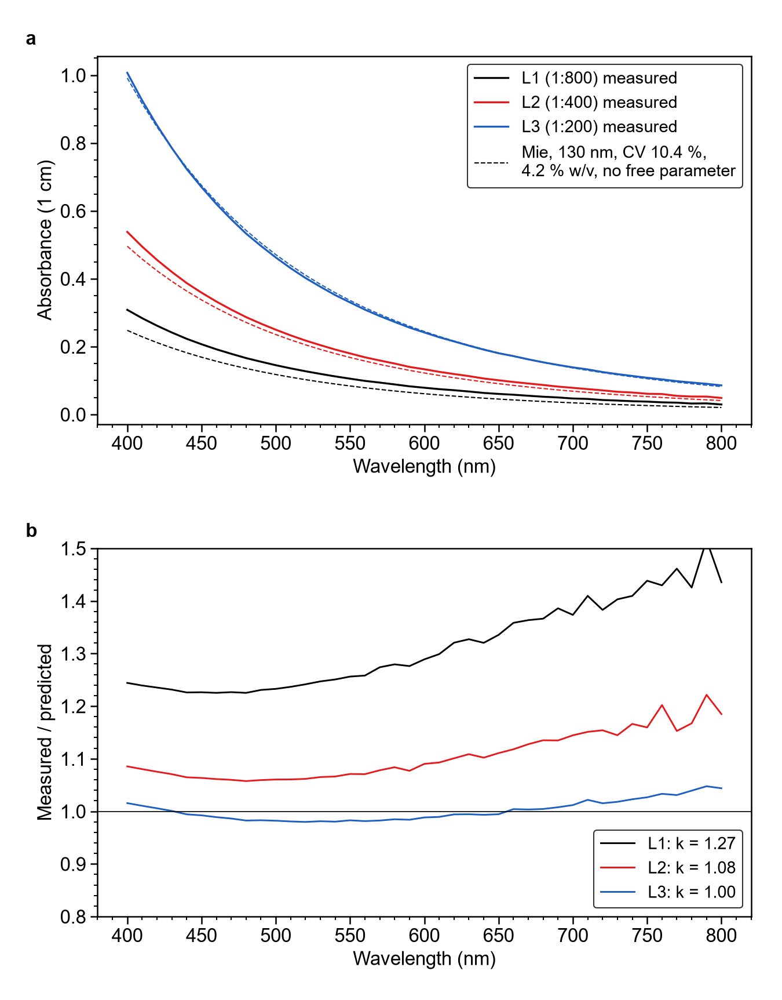
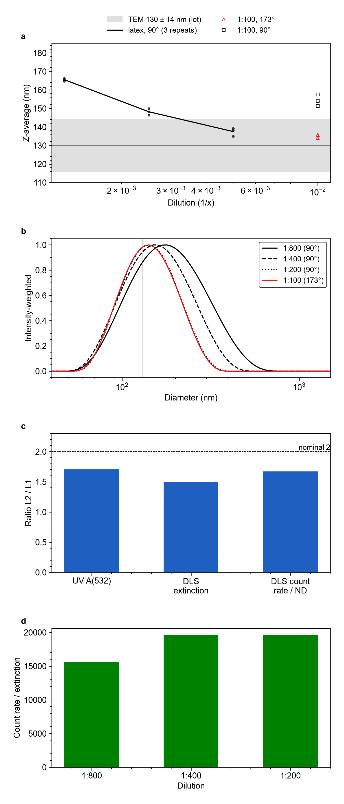
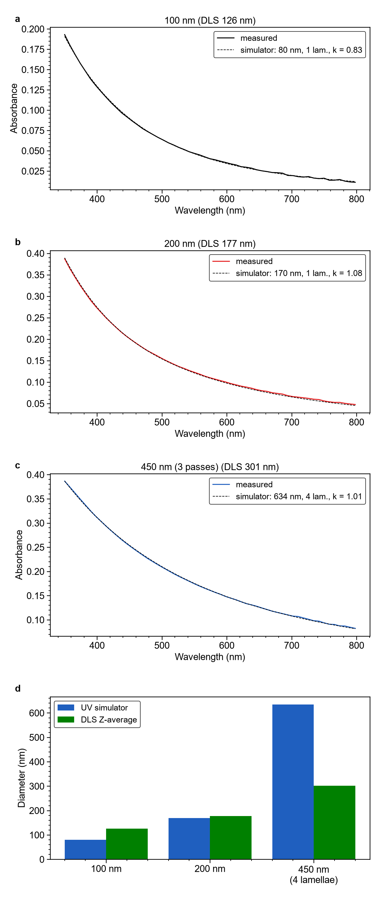
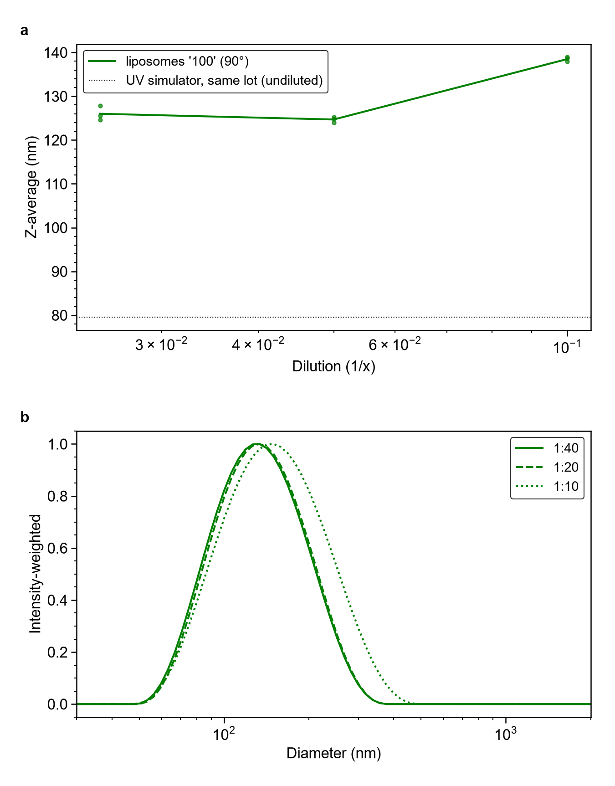
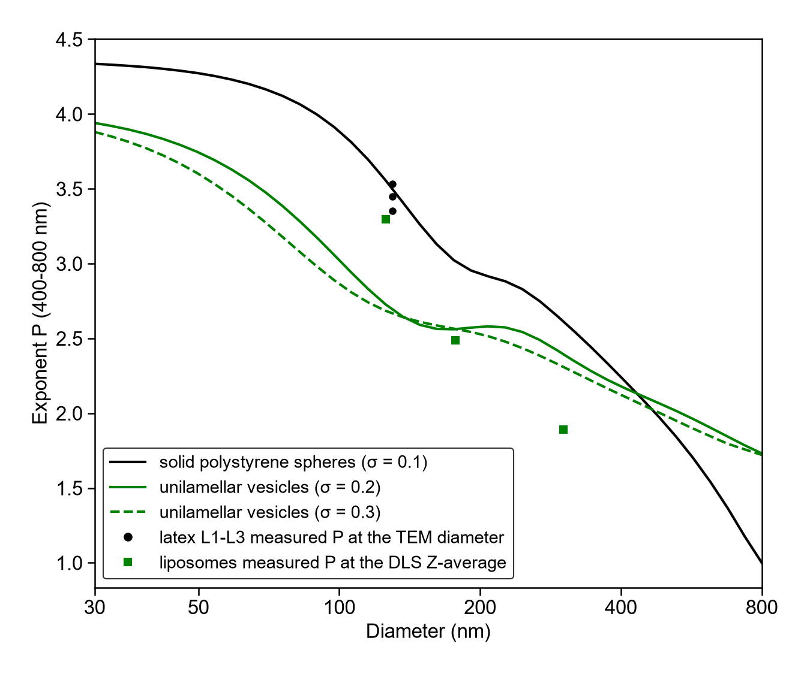

# Particle size from UV-Vis turbidity, checked against DLS and a latex standard

Report on the *Spectrum simulator*, and the theoretical P(d) curve of LabSpectrumManager, compared with DLS, tested on
a 100 nm carboxyl latex standard (certified lot) and on POPC-cholesterol-PEG liposomes, with UV-Vis (`.dsp` spectra,
1 cm and 0.1 cm cuvettes) and DLS (Horiba SZ-100, 532 nm). Measurements of 18-19 November 2026. All numbers
below are printed by [`make_figures.py`](make_figures.py) from the example data (not in the repository, it holds
real samples); the figures are produced by the same script.

## 1. Summary

| Question | Answer | Evidence |
|---|---|---|
| Does the UV-Vis spectrum of a size standard follow Mie theory in **absolute** scale, with no free parameter? | **Yes.** On the two more concentrated dilutions (A(500 nm) 0.25-0.47) the measured spectrum is within 0-8 % of the prediction from the certificate (130 nm, CV 10.4 %, 4.2 % w/v), and the shape agrees within 1.6-2.0 %; the most dilute sample (A(500 nm) 0.15) is 27 % above it | Section 3.1, Fig. 1 |
| Does the exponent P of the spectrum agree with the certified size? | **Yes**, 3.35-3.53 measured against 3.5 predicted at 130 nm. At the DLS diameters (150-165 nm) the model would give 3.1-3.3 | Section 3.1, Fig. 5 |
| Do UV-Vis and DLS agree on the latex? | **Yes, within 6-17 % in amplitude and 2-5 % in shape** when the DLS Z-average is used as the diameter. DLS is 6-27 % larger than the certified TEM diameter (90°); at 173° it is within 4 % | Section 3.2, Fig. 2 |
| Is the dilution series consistent? | The three independent measures of the L2/L1 ratio (UV, DLS extinction, DLS count rate) agree with each other (1.5-1.7) and all sit below the nominal 2: the concentration of the most dilute sample is known to about ±25 % | Section 3.3, Fig. 2c |
| Does the UV simulator give the size of the liposomes? | **At 200 nm, yes** (170 nm against 177 nm DLS). At 100 nm it gives 80 nm against 126 nm DLS, and for the 3-pass 450 nm batch about 630 nm with 4 lamellae against 300 nm DLS (intensity-weighted, PI 0.38). The simulator fits all three spectra to 0.001 absorbance, so fit quality alone does not validate a size | Section 4, Fig. 3 |
| What limits the accuracy? | The absolute scale for vesicles (bilayer thickness x index, a factor 2-3), the size-width degeneracy of a smooth spectrum, the concentration, and for DLS the intensity weighting and a dust/aggregate tail | Sections 5-6 |

For a drug-delivery research line, where a 30 % error on the size is tolerable, the method is already useful
for **monodisperse standards and for the larger unilamellar sizes**, and as a **consistency check** of DLS
and of the dilution; for 100 nm vesicles and multilamellar batches the answer must be read together with DLS.

## 2. Methods

**UV-Vis model.** Absorbance `A = path / ln10 · N · C_ext(λ)`, with `N` the particle number density and `C_ext`
the extinction cross-section from Mie theory (Bohren-Huffman), averaged over a log-normal size distribution
(`σ ≈ CV`, `σ ≈ √PI` for DLS-derived widths). The light scattered within the collection half-angle of the
spectrophotometer (10°, instrument-specific) still reaches the detector and is subtracted from the extinction.
Solid spheres (latex): `N` from % w/v of solids, density 1.055 g/mL and the polystyrene index 1.591 at 590 nm
with an approximate Cauchy dispersion. Vesicles: coated sphere (water core), bilayer 4.5 nm, index excess 0.155 (egg lecithin, section 9),
`N` from the lipid concentration and the area per lipid; multilamellar vesicles are one shell of repeat
distance 7 nm with the index averaged over the water gaps. *k* = measured / predicted amplitude (1 = the
absolute scale agrees).

**DLS** (analysed in DLSManager, not in LabSpectrumManager). Cumulant Z-average and PI from the stored correlogram (43 delays), regularised NNLS inversion and one
or two log-normal peaks (BIC), `q = 4π n sin(θ/2) / λ` with λ = 532 nm; checked against the instrument's own
Z-average (within 1-2 %). Count rates are divided by the neutral-density filter transmission; the self-attenuation
of the 1 cm (laser) x 0.4 cm (towards the 90° detector) cell is corrected with the measured transmission.

**Latex lot (certificate of analysis, lot 1229748, Molecular Probes, 17 Sep 2012).**

| Mean diameter (TEM) | SD / CV | Solids | Density | n (590 nm) | Particles / mL |
|---|---|---|---|---|---|
| 130 nm | 14 nm / 10.4 % | 4.2 % w/v | 1.055 g/cm³ | 1.591 | 3.5 x 10¹³ |

Internal check: 4.2 % / 1.055 divided by the volume of a 130 nm sphere gives 3.46 x 10¹³ per mL. The product is
sold as "0.1 µm", the lot is 130 nm: the nominal size should not be used.

**Samples.** Latex diluted in 10 mM NaCl from a 1:20 intermediate (25-200 µL in 1 mL; L1 1:800, L2 1:400,
L3 1:200, L4 1:133, L5 1:100); UV in 1 cm cuvette, blank = solvent. Liposomes in PBS: 100 and 200 nm as
undiluted stock in a 0.1 cm cuvette, the 3-pass 450 nm batch at 1:40 in 1 cm; DLS at 90°.

## 3. Latex standard

### 3.1 UV-Vis against Mie theory

*Fig. 1. (a) Measured spectra (solid) and the absolute Mie prediction for the certified lot (dashed, no free
parameter). (b) Measured / predicted ratio against wavelength.*

| Sample | Dilution | Solids (% w/v) | k (400-800 nm) | Shape residual | Diameter for k = 1 | P (400-800) |
|---|---|---|---|---|---|---|
| L3 | 1:200 | 0.0210 | 1.00 | 1.6 % | 130 nm | 3.53 |
| L2 | 1:400 | 0.0105 | 1.08 | 2.0 % | 135 nm | 3.45 |
| L1 | 1:800 | 0.0053 | 1.27 | 3.3 % | 146 nm | 3.35 |

The most concentrated sample (A(532 nm) = 0.37) reproduces the certified lot exactly in scale and shape. The
excess in the dilute samples is a *higher* absorbance than predicted, and it grows toward the red (Fig. 1b), where
the absorbance is below 0.05 and a small additive offset weighs more. The model P at 130 nm is 3.5
(3.56 at 126 nm, 3.41 at 137 nm); the measured values 3.35-3.53 lie on the theoretical curve at the certified
size (Fig. 5), whereas the DLS diameters 150-165 nm would predict 3.1-3.3.

### 3.2 DLS and the comparison with UV-Vis

*Fig. 2. (a) Z-average against dilution (three repeats each) with the certified size; (b) regularised intensity
distributions, repeat 1 (vertical line: 130 nm); (c) ratio of the signals of the two dilutions L2/L1 (nominal 2); (d) count rate / extinction (ND and cell self-attenuation corrected) for the three dilutions.*

| Sample | Angle | Z-average (nm) | PI | Z / TEM | Count rate (kCPS) | ND filter |
|---|---|---|---|---|---|---|
| 1:800 | 90° | 165.5 | 0.14 | 1.27 | 4169 | 100 % |
| 1:400 | 90° | 148.2 | 0.07 | 1.14 | 697 | 10 % |
| 1:200 | 90° | 137.5 | 0.06 | 1.06 | 933 | 10 % |
| 1:100 | 173° | 135.1 | 0.09 | 1.04 | 4145 | n/a |
| 1:100 (second tube) | 90° | 154.4 | 0.12 | 1.19 | 1700 | n/a |

A lot with CV 10 % has a PI of about 0.02, so the measured 0.06-0.14 and the Z-average above the TEM diameter
indicate a tail toward larger sizes, more visible at 90° than at 173° (back-scattering is less sensitive to
large aggregates). The hydrodynamic diameter is also expected to be somewhat larger than the TEM one (hydration,
carboxyl layer). The comparison of the two angles is not a controlled one (different tubes, different
transmission); the individual two-peak decompositions of the correlograms are not stable between repeats.

**UV predicted from the DLS result.** Using the Z-average as the diameter of one narrow population (σ 0.05) and the
certified solids, the predicted spectrum is within 6-17 % in amplitude and 2-5 % in shape:

| Sample | Z-average | k (400-800) | Shape residual |
|---|---|---|---|
| 1:800 | 165.5 nm | 0.83 | 4.9 % |
| 1:400 | 148.2 nm | 0.87 | 3.2 % |
| 1:200 | 137.5 nm | 0.94 | 2.0 % |

Using the two-peak DLS decompositions instead gives shape residuals of 16-19 %: the tail of those fits is not
reliable enough to predict a spectrum. In the other direction, the UV amplitude at k = 1 gives 146, 135 and
130 nm against 165.5, 148 and 137.5 nm from DLS (the DLS one is larger by 13 %, 10 % and 6 %).

### 3.3 Consistency of the dilutions

| Quantity | L2 / L1 (nominal 2) |
|---|---|
| UV absorbance at 532 nm | 1.71 |
| DLS extinction ln(I0/T) from the transmitted laser intensity (I0 = 31751) | 1.49 |
| DLS count rate / ND transmission | 1.67 |

The three independent measures agree with one another and sit below 2, i.e. the real ratio of concentrations
is about 1.6 and the most dilute sample (L1) holds more latex than its nominal dilution (consistent with its
k = 1.27 in Table 3.1). With the intermediate 1:20 dilution the volumes are 25-50 µL in a 200 µL pipette, at the
low end of its range, but the volumes actually pipetted were not recorded, so the cause is not established.
The count rate divided by the extinction, once the cell self-attenuation is corrected, is the same for 1:400
and 1:200 (19605 and 19610 kCPS per unit extinction, ratio 1.00 at a factor 2 in concentration), which validates the
geometry correction; the 1:800 value is 20 % lower, as would happen if the "10 %" filter were not exactly 10 %.

## 4. Liposomes (POPC-cholesterol-PEG)

*Fig. 3. Measured spectra (solid) and the best simulator fit (dashed: diameter and k free, σ = 0.2).*

| Batch | UV simulator: diameter | Lamellae | k | rms (absorbance) | DLS Z-average (nm) | DLS PI | P (400-800) |
|---|---|---|---|---|---|---|---|
| 100 nm | 80 nm | 1 | 0.83 | 0.0008 | 125.6 | 0.10 | 3.30 |
| 200 nm | 170 nm | 1 | 1.08 | 0.0019 | 177.1 | 0.19 | 2.49 |
| 450 nm (3 passes) | 634 nm | 4 | 1.01 | 0.0009 | 301 (299-303) | 0.38 | 1.89 |

* **200 nm:** UV and DLS agree to 4 %. P (2.49) sits on the vesicle curve at that size (Fig. 5).
* **100 nm:** the spectrum is steeper (P = 3.30) than a 126 nm vesicle population would give (2.7), so the UV
  points to smaller vesicles, about 80 nm. The DLS Z-average is stable at 125 nm at 1:20 and 1:40 (3 repeats
  each; 1:10 gives 138.5 nm), see Fig. 4. The 47 nm minor peak seen on 18 November in one decomposition did not
  reproduce. Converting the intensity distribution to a number distribution gives a median of 115 nm and does not
  change the UV shape. The discrepancy (UV 0.63 of DLS) is not explained: it is outside the 30 % tolerance and
  is the main open point for liposomes.
* **450 nm (3 passes):** the amplitude alone (10 mg/mL) is compatible with about 4 lamellae (3 give k = 1.35, 7 give
  k = 0.58 and a worse residual, 0.0014 against 0.0009); size and half-angle are degenerate for large particles, so
  the 634 nm is a model-dependent figure against a DLS of 300 nm
  (PI 0.38, so the Z-average is not a size of a single population).
* The simulator reproduces every spectrum to 0.001 absorbance with two free parameters; the agreement with DLS
  at 200 nm is the informative result, not the quality of the fit.
* The absolute amplitude depends on bilayer thickness x index (a factor 2-3); with the default index excess 0.155
  the two unilamellar samples give k = 0.8-1.1, i.e. the absolute scale agrees within about 20 %. A 85/10/5
  POPC/cholesterol/DSPE-PEG2000 mixture lowers k from 1.08 to 0.94 on the 200 nm sample (0.83 to 0.72 on 100 nm)
  without changing the size.

*Fig. 4. Liposomes "100": (a) Z-average against dilution (3 repeats each; dotted: the size fitted from the UV
spectrum); (b) regularised intensity distributions (repeat 1).*

## 5. Putting UV-Vis and DLS together

*Fig. 5. Exponent P of a pure power law fitted to 400-800 nm, from Mie theory (curves) and measured (points).*

| | UV-Vis turbidity | DLS (Z-average) |
|---|---|---|
| What it weights | the mass-weighted extinction (at fixed mass about d³ in the Rayleigh limit) | scattered intensity, about d⁶ per particle in the Rayleigh limit: dominated by the largest particles |
| Needs | concentration, index (and bilayer thickness for vesicles), the instrument half-angle | dilution to single scattering, viscosity, index of the solvent |
| Sensitive to | the mean size and the width together (degenerate); the absolute scale | aggregates and dust; multiple scattering at high optical depth |
| Latex 130 nm | 130-146 nm (k = 1), shape and P agree with the TEM | 135 nm (173°), 138-165 nm (90°) |
| Liposomes 200 nm | 170 nm | 177 nm |

Agreement between the two is therefore strongest where the sample is narrow and the concentration known; where
they differ, the difference carries information (a tail, a multilamellar fraction, a wrong concentration).

## 6. Practical implications

1. **Dilution is part of the protocol.** Work at A(500 nm) = 0.1-0.25 in 1 cm (transmission above 0.6, no multiple
   scattering); on the latex that is 1:400-1:800 (L2-L1), while 1:200 gives A(500) 0.47 and the more concentrated ones
   (1:133, 1:100, A(500) 0.7-0.9) are too turbid for DLS at 90°. Use an intermediate dilution so that every pipetting is above 20 µL.
2. **Record the concentration.** The amplitude of the spectrum gives the size only if the concentration is known
   within about 20 %: a 5 % error in diameter is a 12 % error in amplitude. For the latex, the lot solids (4.2 %, not
   the nominal 4 %) change the predicted amplitude by 5 %.
3. **Use the certified size of the lot, not the nominal one.** The "100 nm" latex is 130 nm; against 100 nm the
   spectrum would have looked 40 % off.
4. **DLS:** record the transmission before and after (blank I0 = 31.7 x 10³ counts), correct the count rate for the ND
   filter, run three repeats, and when the Z-average changes with dilution or angle look at the PI and the
   count rate; prefer 173° for dust-sensitive samples when the instrument allows it. Do not use the two-peak
   decomposition to predict a spectrum.
5. **Workflow in the program:** select the spectrum, open the Spectrum Simulator, set the concentration, cuvette and
   (for latex) the sample type, press *Fit size + amplitude* (the result does not depend on the starting diameter); read k: close to 1 means the concentration and the model are right, a different
   k with a size close to the DLS one points to the concentration or to the shell (lamellae).
6. **Expected accuracy** (this study): standard of known composition, concentration and index: size within about 10 %
   and amplitude within about 10 % at the right dilution; unilamellar 200 nm liposomes: size within 4 % of DLS, with
   k = 1.1 (the two unilamellar samples agree in scale within 20 %); 100 nm liposomes: UV and DLS differ by 37 %; multilamellar batches:
   size not determined by UV alone.

## 7. Theoretical implications

* **The exponent P is a size probe only below about 130-190 nm.** For solid spheres P(d) falls from 4.3 (30 nm) to
  3.0 at 180 nm and stays near 2.9-2.8 from 190 to 250 nm; for vesicles it is 2.5-2.7 from 120 to 250 nm and 2.0 at
  400 nm: above about 190 nm a spectrum alone gives the size only through the absolute amplitude and the width.
* **A smooth spectrum is degenerate in diameter and width.** For the latex L1 (earlier analysis, nominal 4 % solids), widening σ from 0.2 to 0.5 moves
  the best median from 124 to 64 nm while k goes from 1.2 to 2.4: the shape alone cannot fix both, which is why the
  absolute amplitude (known concentration) is the key constraint.
* **A pure power law with offset 0 and no linear term** is the right empirical model for non-absorbing particles;
  the Rayleigh exponent of about 4 holds only for particles below about 40 nm. A free offset or slope makes P a poor size
  indicator.
* **Vesicles scatter less than solid spheres of the same size** (P 2.5-2.7 against 3.0-3.6 at 130-180 nm) because
  of the thin shell; multilamellarity raises the amplitude, not the shape, in a size-dependent way.
* **DLS and UV weight the distribution differently**, so a mismatch is not an error of one of them. A tail of large
  particles raises the DLS Z-average and the PI but changes the UV spectrum little.

## 8. Limits and open points

* One latex lot and one instrument pair; two dilutions are enough to compare, not to fit a trend.
* The nominal concentration of L1 is uncertain by about 25 % (the volumes pipetted were not recorded).
* The polystyrene index is the certified 1.591 at 590 nm with an approximate dispersion, worth about ±30 % on the
  amplitude; the collection half-angle (10°) is instrument-specific.
* DLS is larger than the TEM diameter (6-27 % at 90°); the cause (aggregates, dust, angle, electrostatics at
  10 mM NaCl) is not resolved. 173° gives 135 nm; the 90° repeat on a second tube gives 154 nm.
* Liposomes: no independent measurement of the number of lamellae (cryo-TEM, SAXS, phosphate assay) and no
  explanation for UV 80 nm against DLS 126 nm on the 100 nm batch.
* Not tested: other latex sizes (the "200 nm" and "450 nm" standards were not measured at 1:80), other lipids and
  vesicles below 60 nm.

## 9. Comparison with the literature

The method is not new: the physics and the way of using it are in the literature, which was read for this section
(Khlebtsov et al. 2001 in full; Melik and Fogler 1983, pages 1-7 of the article, i.e. theory and instrumental
corrections, not the experimental part; Lo Pò et al. 2023, pages 1-5 of 13, the fitting method).

| Element of the simulator | In the literature | Status |
|---|---|---|
| Mie theory of a bilayer (coated) sphere | Khlebtsov et al. [1] use the same model, with Bohren and Huffman as the reference | standard |
| Absolute amplitude from the mass concentration (specific turbidity) and wavelength exponent as the two observables | [1]; the exponent depends almost only on the outer radius, the specific turbidity on the shell thickness (4-5 nm for egg lecithin, monolamellar) | standard; our 4.5 nm agrees |
| Average over a size distribution (number-weighted integral of the cross-section) | [1] (gamma distribution, parameter 4), [2] eq. 16, [3] (log-normal for the small particles, Gaussian for aggregates) | standard; the choice of distribution is ours (log-normal, sigma 0.2) |
| Light scattered inside the detector acceptance angle still reaches the detector | [2] treat the finite acceptance half-angle (corrected scattering coefficient, refraction at the cell wall); [1] avoids it with an aperture diaphragm | principle standard; our **10° is an adjusted value** (about 2° in [2], a lens-pinhole instrument) |
| Dispersion of the refractive index of water | [1] eq. 7: 1.3364 at 500 nm | same as ours (1.3365) |
| Shell index excess over water | [1] eq. 8 for egg lecithin: about 1.491 at 500 nm, i.e. an excess of about **0.155** (0.159 at 400 nm, 0.152 at 700 nm) | ours is now 0.155 (the default); see below |
| Fitting window for the exponent | [1]: 400-600 nm | ours: 400-800 nm, so the P(d) curves are not directly comparable |
| Multilamellar vesicles, PEG film, cholesterol, polystyrene dispersion | not found in the three papers | our own approximations |

References: [1] N. G. Khlebtsov, L. A. Kovler, S. V. Zagirova, B. N. Khlebtsov, V. A. Bogatyrev, *Spectroturbidimetry of
liposome suspensions*, Colloid Journal 63(4), 491-498 (2001); [2] D. H. Melik, H. S. Fogler, *Turbidimetric
determination of particle size distributions of colloidal systems*, J. Colloid Interface Sci. 92(1), 161 (1983);
[3] C. Lo Pò, V. Iacono, S. Boscarino, M. G. Grimaldi, F. Ruffino, *Monte Carlo approach to the evaluation of nanoparticles
size distribution from the analysis of UV-Vis-NIR spectra*, Micromachines 14, 2208 (2023), doi 10.3390/mi14122208.
The formulas of [1] were read from a scanned copy in which some symbols are badly rendered: the coefficients of
eq. 7 and 8 should be checked against the original before being used in the code.

**Effect of the shell index.** The amplitude of a thin shell goes roughly as (thickness x index excess)^2 ([1], eq. 21-22),
so 0.155 instead of the rounded 0.12 used in the first version of the simulator raises the predicted spectrum by about
1.7. Refitting the three liposome spectra with the two values (everything else unchanged: bilayer 4.5 nm, sigma 0.2,
half-angle 10°; 7 lamellae for the 450 nm batch in both columns):

| Batch | Excess 0.12: d, k | Excess 0.155: d, k |
|---|---|---|
| 100 nm | 79.6 nm, 1.38 | 79.5 nm, 0.83 |
| 200 nm | 173.7 nm, 1.78 | 169.5 nm, 1.08 |
| 450 nm (7 lamellae) | 604.5 nm, 0.98 | 604.7 nm, 0.58 |

The sizes do not change (within 3 %); the amplitude factor of the two unilamellar batches moves from 1.4-1.8 to 0.8-1.1,
i.e. the absolute scale agrees within about 20 %. The 450 nm batch then needs about 4 lamellae (k = 1.01) instead of 7:
the number of lamellae is therefore as uncertain as the shell index. This is a test on three spectra and on a lecithin
index of another lipid mixture (egg lecithin; ours contain cholesterol and PEG-lipid), not a calibration: the shell
index of the real vesicles is not measured, and [1] itself reports that the specific turbidity of lecithin from a
different supplier was markedly lower. The simulator default is therefore 0.155 (editable), to be validated by an independent measurement of the shell (for
example a phosphate assay, which also fixes the lipid concentration, and cryo-TEM for the number of lamellae).

**Size distribution.** [1] stresses that the average size of a polydisperse suspension depends on the type of average:
for their gamma distribution the weight-average size is twice the modal one. A broad population can therefore give a
smaller size from the spectrum than the intensity-weighted DLS Z-average, as for the 100 nm liposomes (80 nm against 126 nm).
This is compatible with the discrepancy but does not prove it: the simulator assumes sigma = 0.2.

## 10. Reproducing the numbers

`py report/make_figures.py` from the repository root (needs the data folders `size da spettro scattering/20251118
Lipo varie size`, `20261118 lipo vuoti varie size DLS`, `20261119 lattice 100 nm`, `20261119 DLS lattice e
liposomi` and `scipy`; PlotStyleKit is used for the style if found next to the project). The DLS part of the script used
the `.nsz` reader and the correlogram analysis of LabSpectrumManager, which were moved out of it on 2026-11-21: that
part no longer runs here and needs the reader of DLSManager. The figures in `figures/` are the ones of the report.
